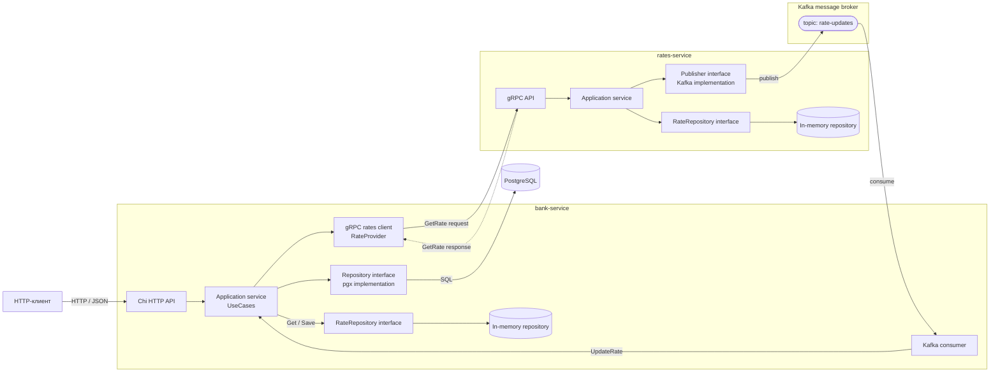

# Bank System Go

- **bank-service** - HTTP API, JWT/RBAC, счета, друзья, пополнения, снятия, переводы, PostgreSQL;
- **rates-service** - генерация курсов USD/EUR, синхронный gRPC API и периодические Kafka-обновления;

Основной стек: Go 1.26, Chi v5, pgx v5, Goose v3, gRPC, Protocol Buffers, franz-go, JWT

## Архитектура



Направления взаимодействия:

1. Клиент обращается только к `bank-service` по HTTP.
2. `bank-service` хранит банковские данные в PostgreSQL через интерфейс `Repository`.
3. `bank-service` хранит локальные копии курсов через собственный интерфейс `RateRepository`; его текущая реализация находится в `infrastructure/memory`.
4. Kafka consumer передаёт событие в application service через `UpdateRate`.
5. При отсутствии свежего курса в локальном репозитории `bank-service` синхронно вызывает `rates-service` через unary gRPC `GetRate`. Ответ возвращается в рамках того же вызова.
6. `rates-service` также работает с курсами через свой интерфейс `RateRepository`; сейчас его реализует потокобезопасный in-memory-репозиторий.
7. `rates-service` периодически обновляет курсы и публикует события `rate-updates` в Kafka. Это однонаправленный асинхронный поток: `rates-service → Kafka → bank-service`.

Денежные операции выполняются в транзакциях PostgreSQL. Для перевода оба счета блокируются через `SELECT ... FOR UPDATE` в стабильном порядке UUID, что защищает от lost update и дедлоков.

Комиссии настраиваются через `TRANSFER_COMMISSION_OWN` (между счетами одного пользователя), `TRANSFER_COMMISSION_FRIEND` (перевод другу) и `TRANSFER_COMMISSION_DEFAULT`(обычный перевод)

## Быстрый старт

Нужен Docker с Compose:

```bash
cp .env.example .env
docker compose up --build
```

HTTP API будет доступен на `http://localhost:8080`, gRPC rates-service - на `localhost:9090`, PostgreSQL - на `localhost:5433`, Kafka - на `localhost:9092`.

Проверка состояния:

```bash
curl http://localhost:8080/health
```

Тестовый администратор при необходимости создаётся приложением из переменных `BOOTSTRAP_ADMIN_*`. Значения из `.env.example`:

- login: `admin`
- password: `password`

Пароль предназначен только для локального запуска. В production задайте собственные значения или установите `BOOTSTRAP_ADMIN_ENABLED=false`.

Получить токен:

```bash
curl -X POST http://localhost:8080/login \
  -H "Content-Type: application/json" \
  -d '{"login":"admin","password":"password"}'
```

Создать пользователя (подставить admin token):

```bash
curl -X POST http://localhost:8080/api/users \
  -H "Authorization: Bearer ADMIN_TOKEN" \
  -H "Content-Type: application/json" \
  -d '{
    "login":"alice",
    "firstName":"Alice",
    "lastName":"Doe",
    "age":25,
    "gender":"FEMALE",
    "password":"secret123",
    "role":"USER"
  }'
```

## HTTP API

Все маршруты, кроме `/health` и `/login`, требуют `Authorization: Bearer <token>`.

| Method | Path | Назначение |
|---|---|---|
| POST | `/login` | Получить JWT |
| POST | `/api/users` | Создать пользователя (ADMIN) |
| GET | `/api/users` | Фильтры и пагинация пользователей (ADMIN) |
| GET | `/api/users/{id}` | Получить пользователя |
| GET | `/api/users/{id}/accounts` | Счета пользователя |
| GET/POST/DELETE | `/api/users/{id}/friends` | Получить/добавить/удалить друзей |
| POST | `/api/accounts` | Создать счет |
| GET | `/api/accounts` | Фильтры и пагинация счетов |
| GET | `/api/accounts/{id}` | Получить счет |
| POST | `/api/accounts/{id}/deposit` | Пополнение |
| POST | `/api/accounts/{id}/withdraw` | Снятие |
| POST | `/api/accounts/{id}/transfer` | Перевод |
| GET | `/api/accounts/{id}/balance?currency=USD` | Баланс в валюте |
| GET | `/api/balance-operations` | История пополнений/снятий |
| GET | `/api/transfers` | История переводов |


## Проверки

Application services покрыты изолированными unit-тестами на GoMock. В `bank-service` сгенерированные mocks реализуют `Repository`, `Transaction`, `RateRepository` и `RateProvider`; в `rates-service` - `RateRepository` и `Publisher`.

```bash
cd bank-service && go test -race ./... && go vet ./...
cd ../rates-service && go test -race ./... && go vet ./...
```

## Структура

```text
bank-service/
  cmd/bank                composition root
  internal/app            бизнес-логика, UseCases и Repository interfaces
  internal/domain         доменные модели и ошибки
  internal/transport/httpapi       входящий HTTP API на Chi
  internal/transport/kafka         consumer событий rate-updates
  internal/infrastructure/postgres реализация Repository на pgx
  internal/infrastructure/grpc/rates исходящий gRPC-клиент
  internal/infrastructure/memory   потокобезопасная реализация RateRepository
  internal/security       JWT
  migrations              Goose SQL migrations
  go.mod                  независимый Go-модуль
rates-service/
  cmd/rates               composition root
  internal/app            генератор курсов, RateRepository и Publisher interfaces
  internal/domain         доменные модели курсов
  internal/transport/grpcapi       входящий gRPC API
  internal/infrastructure/kafka    publisher событий rate-updates
  internal/infrastructure/memory   потокобезопасная реализация RateRepository
  go.mod                  независимый Go-модуль
go.work                   локальная Go workspace для двух модулей
api/rates/v1/rates.proto  единый protobuf-контракт RateService
buf*.yaml                 генерация gRPC-кода для обоих модулей
docker-compose.yml        совместный локальный запуск инфраструктуры и сервисов
```
